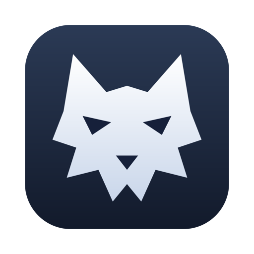
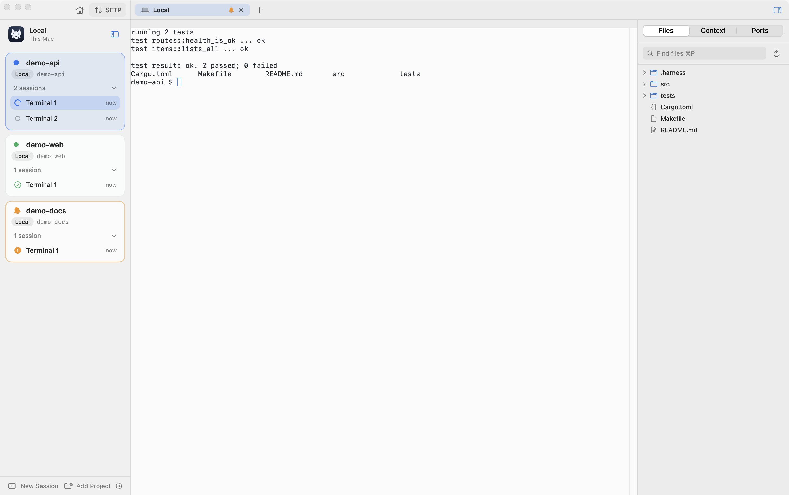
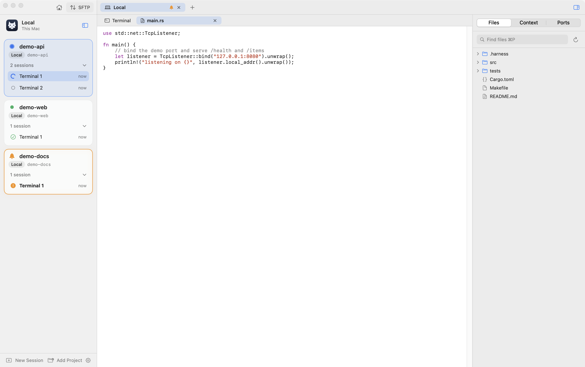

<p align="center">
  
</p>

<h1 align="center">Fenrir</h1>

<p align="center">An agent development workspace for macOS.<br>Run coding agents across your projects, on this Mac or on remote machines, and see at a glance which one needs you.</p>

<p align="center">
  
  
  
  
  
  
  <a href="LICENSE"></a>
</p>

<p align="center">
  
</p>

Fenrir keeps every project you work on in one list. Each project is a card with its sessions underneath; each session is a real terminal. Sessions keep running while you switch, and the card tells you which agent is working, idle, or waiting for input.

**Supported today**

| | |
|---|---|
| Agents | Claude Code |
| Machines | This Mac, any host reachable over SSH, and Coder workspaces |

Built with Swift (SwiftUI, SwiftTerm) for the app and Rust for the core.

<p align="center">
  
</p>

## Features

- **One place for every agent**: a card per project with its sessions underneath. Each row shows whether the agent is working, idle, waiting for permission, or still running subagents, plus the conversation name and how long ago it last changed. Drag cards to reorder; rename projects and sessions (a session rename also renames the agent conversation).
- **Notified when an agent is done**: a macOS notification and a Dock badge when a session finishes or asks for permission, and only once the agent has really stopped, not while it is still writing. Clicking the notification opens that session.
- **Resumes where you left off**: quit and reopen, and every tab, card and session comes back. Agents that were on screen resume their conversation; terminals that were inside tmux attach the same tmux session again. A dropped connection does the same as soon as the host is reachable.
- **Local and remote side by side**: a tab per machine. Add any SSH host or pick a running Coder workspace; each remote terminal is its own login shell in the project folder.
- **Files in the same window**: a live file tree next to the terminal. Create, rename and delete files and folders from the right-click menu, edit text files in tabs and save them back (also on remote hosts), find files as you type.
- **Binary files too**: anything Quick Look can show (PDFs, images, spreadsheets, Word and slide documents) opens in a preview tab; remote ones are downloaded first. Downloads go to a folder you choose, ~/Downloads by default.
- **Ports and transfers**: detect listening ports on a remote host and forward them to localhost; a dual-pane SFTP view with a transfer queue and drag in and out of Finder.
- Light theme by default; dark and system are in Settings.

## Requirements

- macOS 14 or newer, Apple Silicon (the build targets `arm64-apple-macosx14.0`)
- Rust toolchain (`cargo`), Node.js, and the Swift 6 toolchain (Command Line Tools are enough; Xcode is not required)
- For remote machines: key-based `ssh` access (`ssh -o BatchMode=yes <host> true` must work); for Coder workspaces, the `coder` CLI logged in. `tmux` on the host is optional
- An agent: [Claude Code](https://claude.com/claude-code) (state and notifications come from its hooks)

## Build

```sh
git clone https://github.com/khanhnn00/fenrir.git
cd fenrir
scripts/build-app.sh      # builds build/Fenrir.app (ad-hoc signed)
open build/Fenrir.app
```

The first build fetches SwiftTerm 1.2.0 into `build/deps/` and compiles the Rust core. There is no `Package.swift`; the build uses `swiftc` directly. Tests for the core: `cd core && cargo test`.

## Getting started

1. **Add a project**: click Add Project (⇧⌘N) and pick a folder. Press ⌘T for more sessions in it.
2. **Wire the hooks** (once): `node scripts/install-hooks.cjs` adds Fenrir's hook to `~/.claude/settings.json` (a backup is written first; running it again changes nothing). Settings (⌘,) shows whether it is wired.
3. **Add a remote machine**: open a new tab (⌘N), choose Add Machine, then type a host, pick one from `~/.ssh/config`, or pick a running Coder workspace. Fenrir tests `ssh -o BatchMode=yes` before saving it. Then Add Project on that tab with an absolute path on the host.
4. **Remote notifications**: Settings > Remote machines > Install hooks copies the hook to `~/.fenrir/` on the host and adds it to the host's `~/.claude/settings.json` (needs `node` there). Nothing is installed until you press the button.

To try it without touching your own data: `open -n --env FENRIR_HOME=$(mktemp -d) build/Fenrir.app`.

## Shortcuts

| Keys | Action |
|---|---|
| ⌘1 … ⌘9 | Select project |
| ⌘T | New session in the current project |
| ⌘N | New tab (machine picker) |
| ⌘W | Close session |
| ⇧⌘W | Close tab (sessions keep running) |
| ⇧⌘[ / ⇧⌘] | Previous / next tab |
| ⌘K | Quick switch |
| ⌘P | Find files |
| ⇧⌘N | Add project |
| ⌘, | Settings |

## How it works

```
macOS app (terminals, cards, panels)  <-->  core: projects, sessions, ssh, files, transfers, ports
agent hooks --> scripts/fenrir-hook.cjs --> ~/.fenrir/events.ndjson --> app tails it
```

- **Local sessions** are PTYs owned by the core. **Remote sessions** are one `ssh -t <host>` login shell each, started in the project folder with `FENRIR_SESSION` set; a tmux session you start there keeps running on the host when the card closes.
- **State** comes from hooks, not screen scraping: the hook appends `{cwd, session_id, event, ts, fenrir_session}` per event, and the app maps the working directory to a project and updates its card.
- ssh exit 255 is retried in 3 s steps up to 30 s (the card shows Reconnecting). File listing, transfers and status checks for a host share one ControlMaster socket under `~/.fenrir/cm`; terminals and port forwards use their own connections.
- Data lives in `~/.fenrir/` (`fenrir.db`, `events.ndjson`, `sessions.json`); set `FENRIR_HOME` to use another directory.

Source layout: `core/` (Rust core, exposed through UniFFI), `app/Sources/Fenrir/` (SwiftUI app with SwiftTerm; `Generated/` and `CFenrirCore/` are produced by `scripts/build-core.sh`), `scripts/`, `design/` (icon). `AGENTS.md` lists how to exercise every feature end to end.

## Troubleshooting

- **Add Machine fails**: `ssh -o BatchMode=yes <host> true` must succeed without prompts (agent or key). Wildcard `Host` entries (such as `coder.*`) cannot be listed; type the name.
- **`swiftc` fails with a duplicate `SwiftBridging` modulemap**: this is a Command Line Tools issue; `scripts/build-app.sh` already applies the overlay in `scripts/cltfix.yaml.in`.
- **No notifications from a remote host**: install the hooks for that machine in Settings > Remote machines, and check that `node` exists on the host.

## License

[MIT](LICENSE)
